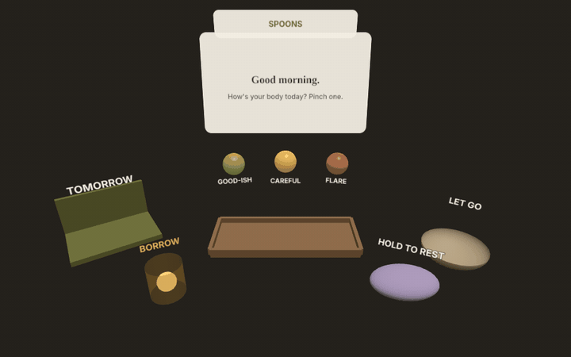
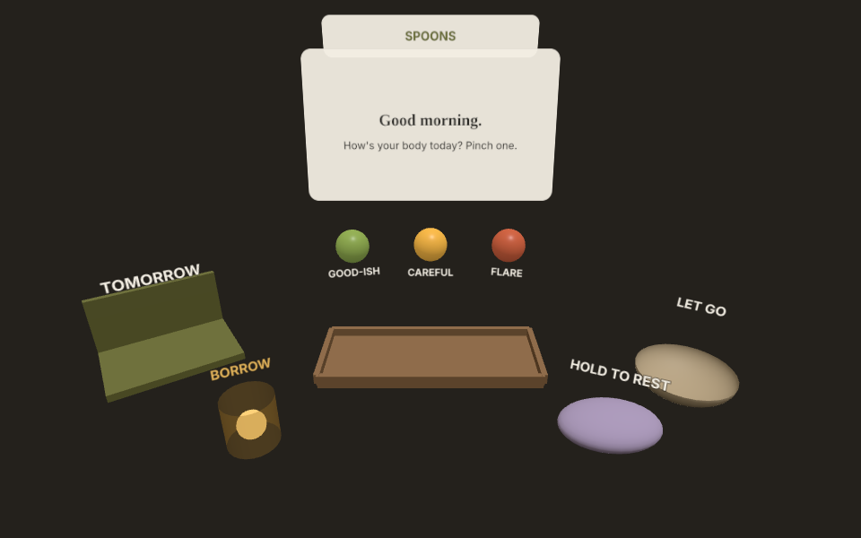
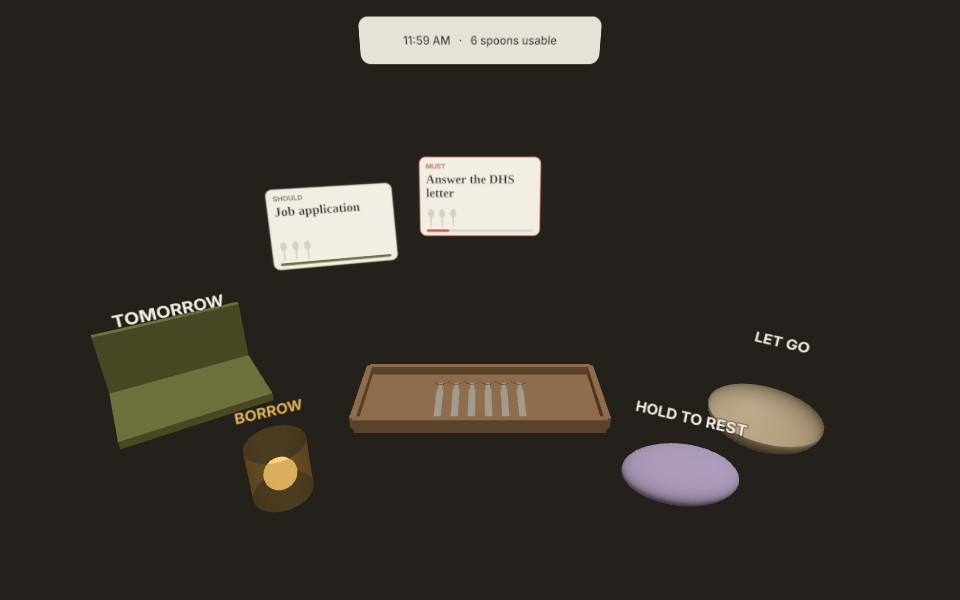
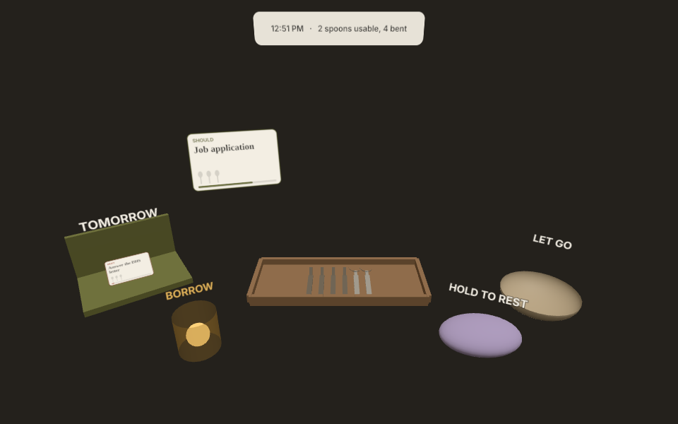
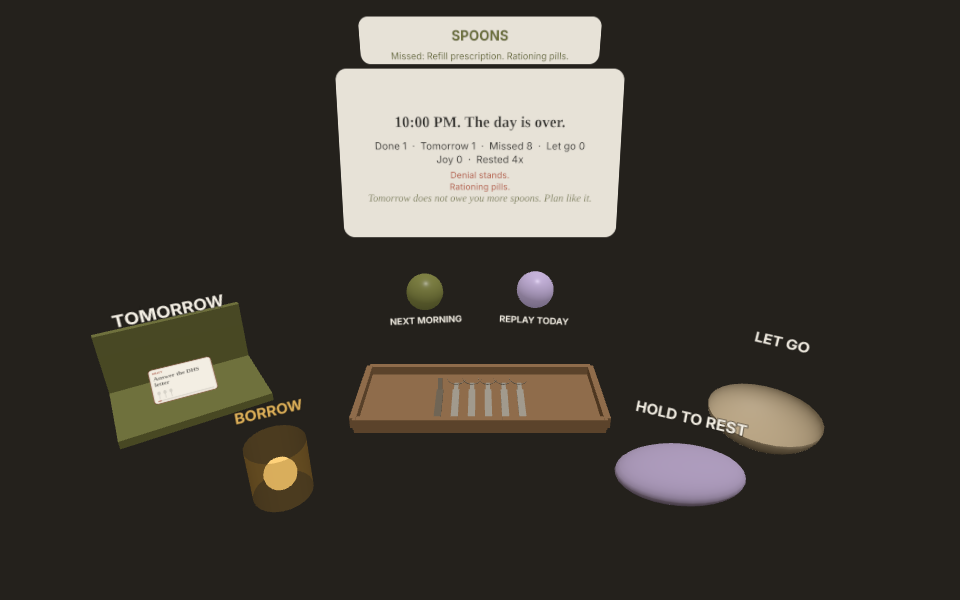

# SPOONS

**A seated, hands-first game about spending your energy.** Spoon theory you can hold.



Every morning you tell the game how your body feels and get a tray of spoons. Tasks float in. Each one costs something. You pick what gets your energy, what waits until tomorrow, and what you let go. Then a flare bends half your tray at 1 PM.

Entry for the [Meta VR Start Developer Competition 2026](https://start-developer-competition-26.devpost.com/) · Gaming track · New Experience.

**Play:** [chanelle.github.io/spoons-vr](https://chanelle.github.io/spoons-vr/) (open in the Meta Quest Browser for passthrough and hands, or drag with a mouse on desktop)

---

## How a day works

| | |
|---|---|
|  | **Morning.** Pinch Good-ish, Careful or Flare. You start with 12, 8 or 5 spoons. If you borrowed yesterday, you start short. |
|  | **The day.** Tasks arrive labeled MUST, SHOULD or WANT, each with a cost and a timer. Pinch a spoon and drop it on a task to pay. Pinch a task and toss it onto **Tomorrow** or into **Let go**. Ignore it and it expires. |
|  | **Flares.** Random and unannounced. Bent spoons can't pay for anything. Hold the pillow to rest, but rest is a gamble: every rest takes a different amount of time, and sometimes nothing comes back. On a flare day it helps less often. The clock keeps running the whole time. |
|  | **10 PM.** What got done, what moved, what you missed and what it cost. Deferred tasks come back the next morning. Borrowed spoons come due at double. |

A day takes about seven minutes. A big clock and a sun crossing the day bar show time slipping away, with chimes at noon, 3, 6, 8 and 9 PM. Each date has its own fixed day of tasks and flares, so tomorrow is always a new run.

## Why hands

Spoon theory came from a woman explaining her illness to a friend by handing her a fistful of spoons and taking one away for every task. You can't really get it from a slide. You have to hold the spoons and feel your hand empty out. In SPOONS you grab each spoon, and heavier tasks sag in your hand.

Spoon theory: [Christine Miserandino](https://butyoudontlooksick.com/articles/written-by-christine/the-spoon-theory/).

## Built for the competition guidelines

- **Hands end to end.** Pinch to grab, release to drop. No controller needed (controllers work too).
- **Airplane seat test.** Everything sits within about 60 cm of your head. The layout is placed in front of you wherever you sit.
- **Bus stop test.** A full day takes about seven minutes, and the game pauses when you take the headset off.
- **Passthrough first.** It runs in your real room via `immersive-ar` and falls back to VR, then to desktop.
- **Take-it-away test.** No AI service and no third-party API. Every asset is procedural: spoons, cards and sound are generated in code, so it starts instantly.

## Run it locally

No build step and no install.

```bash
python3 -m http.server 8765
# open http://localhost:8765
```

Quest needs HTTPS, so use the GitHub Pages link or any static host.

## Code

| File | What it does |
|---|---|
| `src/game.js` | Rules: seeded days, costs, flares, rest, borrowing, carry-over. No rendering. |
| `src/main.js` | Scene, pinch detection from hand joints, controllers, mouse, XR session, recentering |
| `src/art.js` | Procedural spoons, tray, cards and labels (canvas textures) |
| `src/audio.js` | Synthesized sounds (Web Audio) |
| `vendor/` | three.js r170 (MIT) |

```bash
npm test                         # rules tests
node test/smoke.mjs URL OUTDIR   # headless play-through
node test/capture.mjs URL OUTDIR # regenerates the README media
```

## Status

v0.1, playable start to finish on desktop. First headset hand test is next.

Made by [Chanelle Henry](https://chanellehenry.com).
